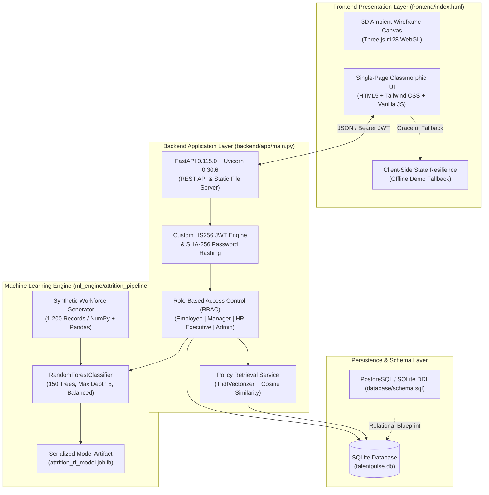
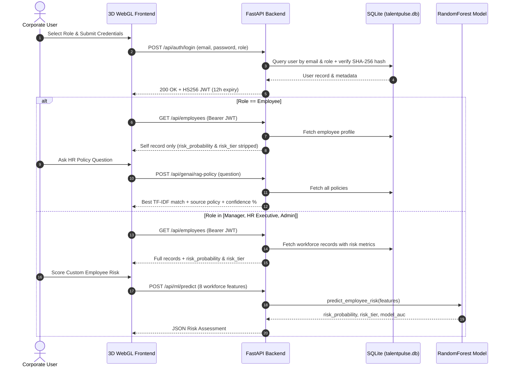
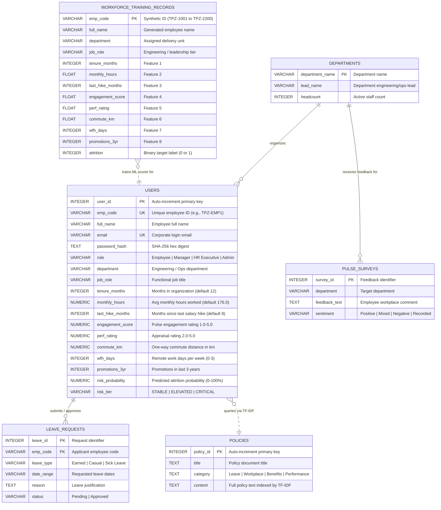

# TalentPulse AI

[](LICENSE)


**TalentPulse AI** is a full-stack workforce intelligence, HR operations, and employee retention platform built for mid-to-large IT delivery centers. Engineered by **Team GG-13 (GenAI Guardians)**, it unifies employee self-service, role-based access control (RBAC), machine learning attrition risk forecasting, and TF-IDF policy retrieval inside an interactive 3D WebGL web application.

---

## Table of Contents

1. [Executive Summary & Problem Statement](#executive-summary--problem-statement)
2. [System Architecture](#system-architecture)
3. [Authentication & Request Sequence Flow](#authentication--request-sequence-flow)
4. [Entity-Relationship (ER) Diagram](#entity-relationship-er-diagram)
5. [Complete Technology Stack](#complete-technology-stack)
6. [Machine Learning Attrition Engine](#machine-learning-attrition-engine)
7. [TF-IDF Policy Retrieval Engine (RAG)](#tf-idf-policy-retrieval-engine-rag)
8. [Role-Based Workspaces & Access Matrix](#role-based-workspaces--access-matrix)
9. [REST API Reference](#rest-api-reference)
10. [Repository Structure](#repository-structure)
11. [Installation & Deployment](#installation--deployment)
12. [Pre-Seeded Demo Accounts](#pre-seeded-demo-accounts)
13. [Security, Privacy & Responsible AI](#security-privacy--responsible-ai)
14. [License](#license)

---

## Executive Summary & Problem Statement

IT delivery hubs regularly experience **20–22% annual turnover**, driven by sustained release overtime, delayed compensation reviews, low engagement, and long daily commutes. By the time an employee submits a resignation letter, intervention is usually too late.

TalentPulse AI addresses workforce retention on two complementary fronts:
* **Predictive Retention Intelligence for Leadership:** A `RandomForestClassifier` trained on 1,200 structured workforce records evaluates 8 operational and behavioral signals to stratify attrition risk (`STABLE`, `ELEVATED`, `CRITICAL`), while strictly masking risk telemetry from non-leadership roles.
* **Unified Employee Self-Service:** A responsive 3D glassmorphic workspace backed by FastAPI, SQLite, and cosine-similarity TF-IDF search enables employees to query HR policies, apply for leave, track company announcements, and submit workplace pulse feedback.

---

## System Architecture



### Key Architectural Decisions
* **Single-Origin Monolithic Delivery:** FastAPI serves both the RESTful `/api/*` endpoints and `frontend/index.html` at `/`, eliminating deployment complexity across local desktop and mobile LAN clients while enabling CORS middleware (`allow_origins=["*"]`) for external API access.
* **Zero-Config Boot & Auto-Seeding:** On application startup (`@app.on_event("startup")`), the backend checks for the synthetic dataset and trained model artifact (running `train_and_save_model()` if absent), initializes SQLite tables (`users`, `policies`), and populates seed accounts and HR policies.
* **Strict API-Level Privacy Enforcement:** `GET /api/employees` dynamically filters records to the authenticated user and strips `risk_probability` and `risk_tier` keys whenever the caller's role is `Employee`, while `POST /api/ml/predict` rejects `Employee` requests with `403 Forbidden`.

---

## Authentication & Request Sequence Flow



---

## Entity-Relationship (ER) Diagram

The relational persistence layer spans **active SQLite runtime tables** (`users`, `policies` in `backend/app/main.py` and `database/schema.sql`), **ML training artifacts** (`workforce_records_1200.csv`), and **operational workflow entities** (leave requests, pulse surveys, and department structures managed in the workspace):



---

## Complete Technology Stack

| Layer | Technologies & Versions | Role in TalentPulse AI |
| :--- | :--- | :--- |
| **Frontend UI & 3D Graphics** | HTML5, Tailwind CSS (CDN), Vanilla JavaScript (ES6+), Plus Jakarta Sans, **Three.js (`r128`)** | Responsive glassmorphic workspace, 3D mouse-tracking tilt card physics, and wireframe WebGL background (`IcosahedronGeometry` & `OctahedronGeometry`). |
| **Backend API Framework** | **Python 3.11**, **FastAPI `0.115.0`**, **Uvicorn `0.30.6`**, **Pydantic `2.9.2`** | Async REST endpoints, Pydantic request validation, auto-generated Swagger/OpenAPI docs (`/docs`), and static HTML serving. |
| **Authentication & Security** | Python `hmac`, `hashlib` (SHA-256), `base64` URL-safe encoding, Custom **HS256 JWT** | Stateless 12-hour bearer tokens, password hashing, credential reset/change workflows, and role-based route protection. |
| **Machine Learning Engine** | **scikit-learn `1.5.2`**, **pandas `2.2.3`**, **NumPy `2.1.1`**, **joblib `1.4.2`** | 1,200-record synthetic workforce data generator, `RandomForestClassifier` training/inference, ROC-AUC scoring, and `.joblib` serialization. |
| **NLP / Policy Retrieval** | **scikit-learn `TfidfVectorizer`**, `cosine_similarity` | Retrieval-augmented HR policy assistant matching natural-language queries against stored policies with confidence scores. |
| **Database & Schema** | **SQLite3** (Python stdlib), SQL DDL (`database/schema.sql`) | Zero-config local relational persistence (`talentpulse.db`) paired with PostgreSQL-ready DDL definitions. |
| **Containerization** | **Docker** (`python:3.11-slim`), `.gitignore` | Reproducible container build that pre-trains the ML model during `docker build` and launches Uvicorn on port `8000`. |

---

## Machine Learning Attrition Engine

Implemented in `ml_engine/attrition_pipeline.py`, the attrition pipeline synthesizes 1,200 realistic IT delivery records (`seed=42`) and trains a balanced ensemble classifier across **8 workforce features**:

| Feature | Type | Range / Default | Behavioral Signal |
| :--- | :--- | :--- | :--- |
| `tenure_months` | `int` | `2 – 72` | Organizational tenure and onboarding stability |
| `monthly_hours` | `float` | `140.0 – 245.0` | Sustained sprint overtime and burnout pressure |
| `last_hike_months` | `int` | `1 – 30` | Compensation stagnation since last appraisal cycle |
| `engagement_score` | `float` | `1.0 – 5.0` | Employee pulse satisfaction and morale |
| `perf_rating` | `float` | `2.0 – 5.0` | Most recent performance evaluation rating |
| `commute_km` | `float` | `1.0 – 42.0` | One-way travel distance to delivery campus |
| `wfh_days` | `int` | `0 – 3` | Weekly hybrid remote-work flexibility |
| `promotions_3yr` | `int` | `0 – 2` | Career progression velocity over 36 months |

* **Algorithm & Hyperparameters:** `RandomForestClassifier(n_estimators=150, max_depth=8, random_state=42, class_weight="balanced")` trained on an 80/20 stratified split and evaluated via **ROC-AUC**.
* **Risk Stratification Thresholds:**
  * `CRITICAL`: Predicted probability $\ge 72.0\%$
  * `ELEVATED`: Predicted probability $45.0\% - 71.9\%$
  * `STABLE`: Predicted probability $< 45.0\%$

---

## TF-IDF Policy Retrieval Engine (RAG)

The `/api/genai/rag-policy` endpoint in `backend/app/main.py` provides grounded policy Q&A without external LLM API keys or latency:
1. Loads all active HR policy titles and bodies from the SQLite `policies` table.
2. Vectorizes policy documents alongside the incoming user question using `TfidfVectorizer(stop_words="english")`.
3. Computes `cosine_similarity` between the query vector and every policy vector, returning the highest-scoring policy content, source title, and percentage confidence score.

---

## Role-Based Workspaces & Access Matrix

| Workspace Feature / Endpoint | Employee | Manager | HR Executive | Admin |
| :--- | :---: | :---: | :---: | :---: |
| **Ask HR Policy Assistant (TF-IDF Q&A)** | Yes | — | — | — |
| **Company Updates & Workplace Pulse Feedback** | Yes | — | — | — |
| **Apply for Leave & View Leave Balance/History** | Yes | — | — | — |
| **Team Attrition Risk Radar (ML)** | Hidden | Pod View | Org-Wide | Org-Wide |
| **Retention Playbook & Stay-Interview Generator** | — | Yes | — | — |
| **Approve Team Leaves & Submit Performance Reviews** | — | Yes | — | — |
| **Employee Directory & Policy Knowledge Base Publisher** | — | — | Yes | — |
| **Pulse Survey Sentiment & Exit Interview Summarizer** | — | — | Yes | — |
| **Onboard New Team Members (`+ Add Employee`)** | — | Yes | Yes | Yes |
| **Department Headcount & System Governance Controls** | — | — | — | Yes |
| **Forgot Password, Change Password & Terms/License** | Yes | Yes | Yes | Yes |

---

## REST API Reference

| Method | Endpoint | Auth | Permitted Roles | Description |
| :--- | :--- | :---: | :--- | :--- |
| `GET` | `/` | Public | All | Serves the 3D WebGL single-page application (`frontend/index.html`). |
| `POST` | `/api/auth/login` | Public | All | Validates email, password, and role; issues a 12-hour HS256 JWT. |
| `POST` | `/api/auth/forgot-password` | Public | All | Resets user password after verifying matching email and role. |
| `POST` | `/api/auth/change-password` | JWT | All | Updates password after verifying the existing password. |
| `POST` | `/api/users/onboard` | JWT | Manager, HR, Admin | Onboards a new user with an auto-incremented `TPZ-*` employee code. |
| `GET` | `/api/employees` | JWT | All | Returns employee records (self-only and risk-masked for `Employee`). |
| `POST` | `/api/ml/predict` | JWT | Manager, HR, Admin | Scores attrition probability and tier for a feature payload. |
| `POST` | `/api/genai/rag-policy` | Public | All | Retrieves the best-matching HR policy using TF-IDF cosine similarity. |

---

## Repository Structure

```text
talentpulse-ai/
├── backend/
│   └── app/
│       └── main.py                # FastAPI routes, HS256 JWT/RBAC auth, SQLite setup & TF-IDF RAG
├── database/
│   └── schema.sql                 # Relational SQL DDL schema for users & attrition features
├── frontend/
│   └── index.html                 # 3D Three.js WebGL UI, role workspaces & interactive modals
├── ml_engine/
│   └── attrition_pipeline.py      # Synthetic workforce generator & RandomForest trainer/predictor
├── Dockerfile                     # Python 3.11-slim container build with build-time model training
├── requirements.txt               # Pinned Python package dependencies
├── .gitignore                     # Ignores venv, __pycache__, *.db, *.joblib, *.csv, .env
├── LICENSE                        # MIT License (Team GG-13)
└── README.md                      # Complete system architecture, ER diagrams & setup documentation
```

---

## Installation & Deployment

### Option 1: Local Python Setup (Windows, macOS, Linux)

1. **Clone the repository and activate a virtual environment:**
   ```bash
   git clone https://github.com/<your-username>/talentpulse-ai.git
   cd talentpulse-ai
   python -m venv venv

   # Windows PowerShell:
   .\venv\Scripts\Activate.ps1

   # macOS / Linux:
   source venv/bin/activate
   ```

2. **Install dependencies:**
   ```bash
   python -m pip install -r requirements.txt
   ```

3. **Train the attrition model (optional — runs automatically on first server boot):**
   ```bash
   python ml_engine/attrition_pipeline.py
   ```

4. **Start the FastAPI server (accessible on desktop & mobile devices on the same Wi-Fi):**
   ```bash
   python -m uvicorn backend.app.main:app --host 0.0.0.0 --port 8000
   ```
   * **Local Browser:** `http://127.0.0.1:8000`
   * **Mobile / LAN Devices:** `http://<your-pc-ipv4-address>:8000`
   * **Interactive API Documentation (Swagger UI):** `http://127.0.0.1:8000/docs`

### Option 2: Docker Deployment

```bash
docker build -t talentpulse-ai .
docker run -d -p 8000:8000 --name talentpulse-ai talentpulse-ai
```

---

## Pre-Seeded Demo Accounts

| Role | Email | Password | Department | Default Risk Tier |
| :--- | :--- | :--- | :--- | :--- |
| **Employee** | `employee@talentpulse.ai` | `Emp@123` | Cloud Engineering | `STABLE` (16.4% — hidden from self) |
| **Manager** | `manager@talentpulse.ai` | `Mgr@123` | Cloud Engineering | `STABLE` (12.1%) |
| **HR Executive** | `hr@talentpulse.ai` | `Hr@123` | HR & Operations | `STABLE` (10.5%) |
| **Admin** | `admin@talentpulse.ai` | `Admin@123` | IT Governance | `STABLE` (8.2%) |

---

## Security, Privacy & Responsible AI

* **Role-Segregated Telemetry:** Individual contributors cannot inspect their own or peers' attrition scores via the UI or REST API, preventing workplace anxiety or punitive misuse.
* **Decision-Support Guardrails:** Retention scores are designed to trigger supportive manager interventions—such as workload rebalancing, hybrid WFH adjustments, and compensation reviews—rather than automated HR actions.
* **Environment Secret Override:** Set the `JWT_SECRET` environment variable in production deployments to override the default local signing key (`talentpulse-gg13-local-signing-key`).

---

## License

Released under the **MIT License** — see the [LICENSE](LICENSE) file for full details.
